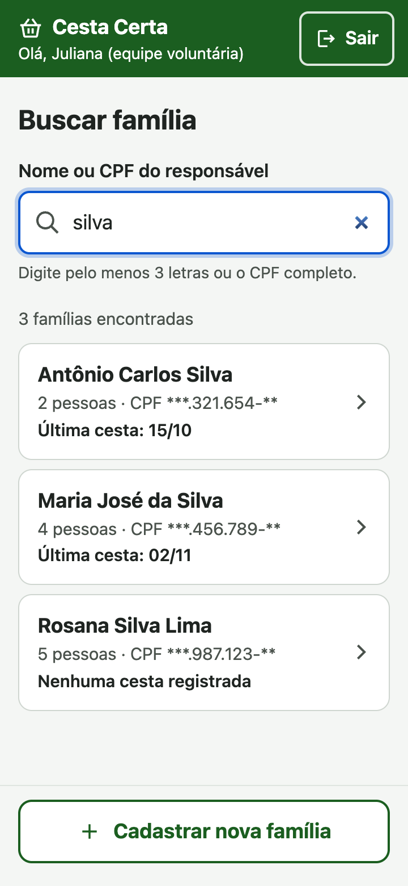
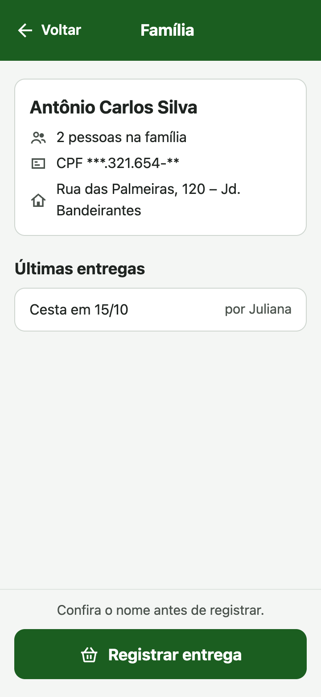
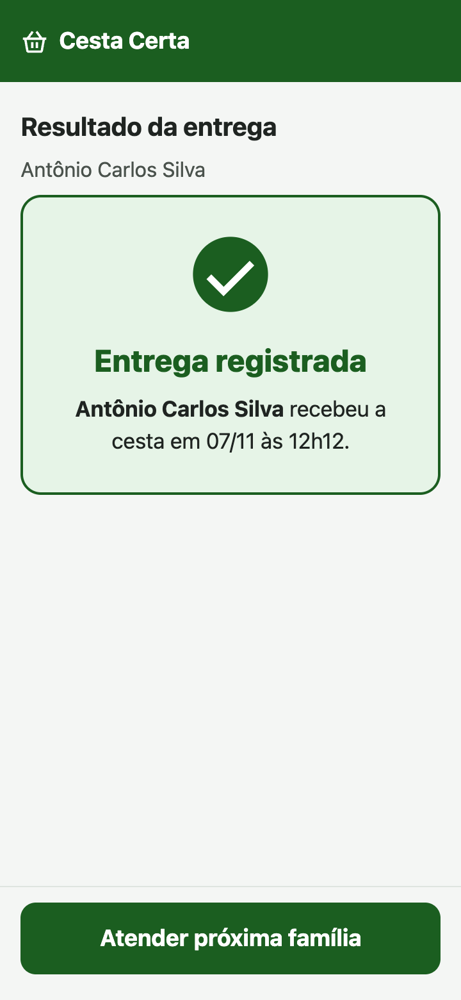
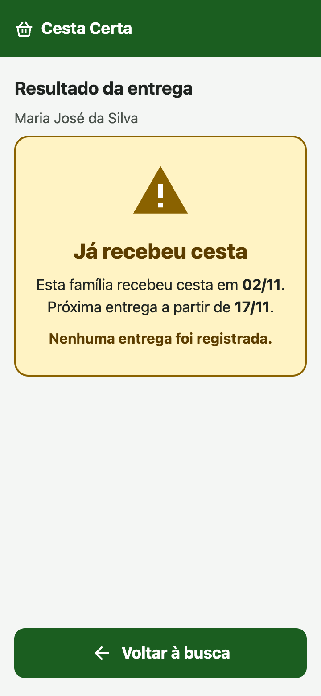

# Cesta Certa

Sistema web (PWA) para controlar a distribuição de cestas básicas da **Associação Comunitária Mãos Unidas**, no bairro Bandeirantes, em Londrina/PR.

O MVP substitui o caderno de papel usado nos sábados de distribuição. O voluntário encontra a família em segundos, registra a entrega e o sistema **impede que a mesma família receba duas cestas em menos de 15 dias**.

> Projeto acadêmico da disciplina de Projeto de Software (ADS). Todos os dados do repositório são **fictícios**.

| | |
|---|---|
| **Problema** | 15% de entregas duplicadas, filas de até 1h30 e 6 h/semana de trabalho administrativo |
| **Usuários** | Cerca de 25 voluntários e a coordenação, que atendem cerca de 180 famílias |
| **ODS** | ODS 2 – Fome Zero (meta 2.1) |
| **Plataforma** | PWA para celular Android simples, com conexão 4G instável |

## Funcionalidades do MVP

| Requisito | Descrição | Situação |
|---|---|---|
| RF01 | Cadastrar família com CPF do responsável único | ✅ |
| RF02 | Buscar família e registrar a entrega da cesta | ✅ |
| RF03 | Bloquear nova entrega em menos de 15 dias, com aviso claro | ✅ |
| RF04 | Relatório mensal de entregas (coordenação) | ✅ |

Requisitos não funcionais atendidos no código:

- **RNF01 – Autenticação:**
  - senha com bcrypt (custo 12);
  - token JWT HS256 válido por 8 h, invalidado no logout por `versao_token`;
  - bloqueio por 15 min após 5 tentativas falhas;
  - mensagem de erro genérica.
- **RNF02 – OWASP:**
  - validação no servidor (Pydantic) e consultas parametrizadas (SQLAlchemy);
  - sem `innerHTML` e com CSP `script-src 'self'`;
  - perfil verificado em cada rota;
  - CPF mascarado para o voluntário (`***.321.654-**`);
  - segredos em variáveis de ambiente;
  - CORS restrito e `/docs` desligado em produção.
- **RNF03 – Desempenho:**
  - busca com uma única consulta;
  - índice em `(familia_id, data_entrega)`;
  - front-end com cerca de 87 kB transferidos.
- **RNF04 – Acessibilidade (WCAG 2.2 AA):**
  - alvos de 48 px, botões de 56 px e cartões de 72 px;
  - texto de 16–18 px e contraste de 4,5:1;
  - rótulos sempre visíveis;
  - alertas com ícone, texto e cor e `role="alert"`.

## Telas

| Tela 1 – Buscar família | Tela 2 – Registro de entrega | Tela 3 – Sucesso | Tela 3 – Aviso |
|---|---|---|---|
|  |  |  |  |

O relatório mensal (RF04) fica acessível só para a coordenação: [captura](docs/capturas-mvp/6-relatorio-mensal.png).

O protótipo navegável que originou as telas está em [docs/prototipo](docs/prototipo/index.html).

## Arquitetura

Arquitetura cliente-servidor, com back-end monolítico em camadas:

```
Angular (PWA)  ──HTTPS/JSON──▶  FastAPI
                                 ├── routers/       rotas e validação de entrada (Pydantic)
                                 ├── services/      regras de negócio (ex.: regra dos 15 dias)
                                 └── repositories/  acesso a dados (SQLAlchemy)
                                          │
                                          ▼
                                    PostgreSQL (Supabase)
```

| Camada | Tecnologia |
|---|---|
| Front-end | Angular 22, `@angular/pwa`, Vitest |
| Back-end | Python 3.13, FastAPI, Pydantic 2, SQLAlchemy 2 + psycopg 3, PyJWT, bcrypt |
| Banco | PostgreSQL 17 (Supabase, plano gratuito) |
| Testes | pytest (unitários + integração com PostgreSQL), Vitest |
| CI | GitHub Actions: lint, testes, build e auditoria de dependências |
| Hospedagem | Vercel (web) e Render (API) |

## Estrutura do repositório

```
backend/
  app/            código da API (routers, services, repositories, models)
  tests/unit/     regras puras: CPF, regra dos 15 dias, segurança
  tests/integration/  API completa com banco de dados
frontend/
  src/app/pages/  login, busca (Tela 1), família (Tela 2), resultado (Tela 3), cadastro
  src/app/core/   serviços, interceptor de autenticação, guards
docs/             protótipo e capturas do MVP
.github/          CI, Dependabot e template de Pull Request
```

## Como executar localmente

Pré-requisitos: Python 3.12+, Node 24 e Docker (para o PostgreSQL local).

```bash
# 1. Banco de dados
docker compose up -d db

# 2. API
cd backend
python -m venv .venv && source .venv/bin/activate
pip install -r requirements-dev.txt
cp .env.example .env          # ajuste JWT_SECRET
python -m app.seed            # cria tabelas e dados fictícios
uvicorn app.main:app --reload # http://localhost:8000/docs

# 3. Web (em outro terminal)
cd frontend
npm install
npm start                     # http://localhost:4200
```

Usuários fictícios criados pelo seed (senhas definidas em `.env`):

| Perfil | E-mail |
|---|---|
| Coordenação | `coordenacao@cestacerta.org.br` |
| Voluntária | `juliana@cestacerta.org.br` |

## Testes

```bash
cd backend && pytest                 # usa SQLite se TEST_DATABASE_URL não estiver definida
cd frontend && npm run test:ci
```

No CI, os testes de integração rodam contra um PostgreSQL 17 real (serviço do GitHub Actions).

## Deploy

1. **Supabase:** crie o projeto e copie a *connection string* para `DATABASE_URL`, no formato `postgresql+psycopg://...?sslmode=require`.
2. **Render:** crie um *Web Service* apontando para `backend/`.
   - Build: `pip install -r requirements.txt`
   - Start: `uvicorn app.main:app --host 0.0.0.0 --port $PORT`
   - Variáveis: `AMBIENTE=producao`, `DATABASE_URL`, `JWT_SECRET` e `CORS_ORIGINS` (URL da Vercel).
3. **Vercel:** importe `frontend/`. O arquivo `vercel.json` já define o build, as rotas da SPA e a CSP. Ajuste a URL da API em `src/environments/environment.production.ts` e em `connect-src`, no `vercel.json`.
4. **GitHub:** em *Settings → Variables*, crie `API_URL`. A rotina `manter-ativo.yml` consulta `/saude` todo dia, para evitar a pausa do Supabase.

## Fluxo de trabalho

- Branch `main` protegida. Cada funcionalidade é feita em uma branch (`feat/...`, `fix/...`) e integrada por **Pull Request**, com o checklist de auto-revisão do template.
- Commits seguem o padrão [Conventional Commits](https://www.conventionalcommits.org/pt-br/), por exemplo `feat(entregas): ...`, `test(api): ...` e `ci: ...`.
- O CI precisa estar verde para o merge.

## Validação com a comunidade

Os resultados das rodadas de teste de usabilidade com a Associação Mãos Unidas e os ajustes feitos a partir deles serão registrados em `docs/validacao/`.
